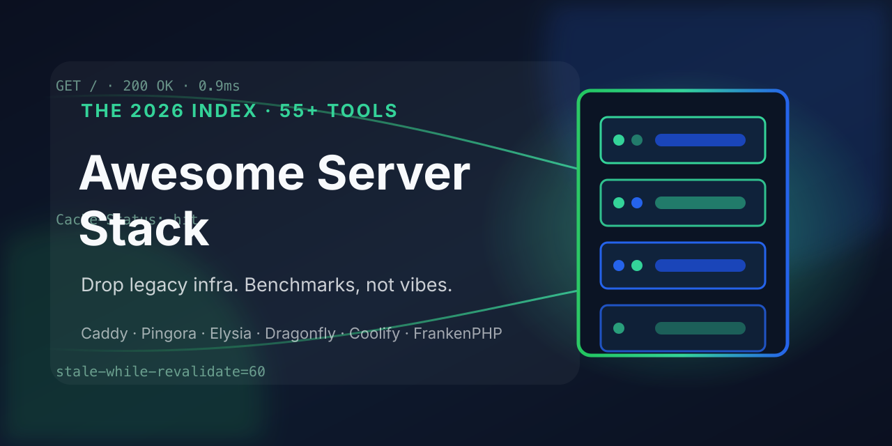

<p align="center">
  
</p>

# 🖧 Awesome Server Stack 2026

> **Drop legacy infra. Benchmarks, not vibes.**
> Curated from 137K+ GitHub repos · live-verified against the GitHub API · October 2026

[](https://awesome.re)
[](#-decision-matrix)
[](#-agent-query-api)
[](../../compare)
[](.)

---

## 💥 WTF is this?

Your server stack learned its defaults in 2015 — Apache configs, "just use nginx", Redis clusters, Vercel bills.
This list tells you what **actually replaced them** — with proof, not star counts alone.

> **Real example:** [Pingora] — the proxy framework Cloudflare open-sourced in Rust — serves **over a trillion requests a day** at Cloudflare's edge. The thing powering ~20% of the web is now a library you can `cargo add`.

> **Another one:** An [independent benchmark](https://two-techies.com/blog/dragonfly-vs-redis-valkey-benchmark) drove a Redis Cluster the way *your app actually drives it* — one normal client — and got 4.6M ops with a catastrophic 84ms p50. A single [Dragonfly] process: **15.5M ops, 0.88ms p50**. (Fully-driven, the cluster hits 40M — the gap is ops complexity, and that's the point.)

> **And the plot twist:** Varnish Cache **renamed itself to [Vinyl Cache]** in September 2025 — GitHub org archived, code moved to a self-hosted Forgejo, 9.0 released under the new name in March 2026. If your runbook still says "varnish", your docs silently aged while you weren't looking.

Every entry here has a story like that. Let's go.

---

## ⚡ TL;DR — Top 10 Drops Right Now

| Drop this | Use this instead | Real gain |
|-----------|-----------------|-----------|
| `Apache` vhost sprawl + certbot | [Caddy] | automatic HTTPS + HTTP/3 · 2-line config |
| "nginx or nothing" reflex | [Pingora] · [Sōzu] | programmable Rust proxy · runtime-configured, no reloads |
| `Express` on Node | [Elysia] / [Hono] on [Bun] | ~10× RPS in minimal benches · web-standard APIs |
| Redis *cluster* ops | [Dragonfly] | one process, ~3.4× a realistic cluster client |
| `memcached` | [Garnet] · [Pogocache] · [Dragonfly] | protocol-compatible, multithreaded, modern |
| The Vercel/Netlify bill | [Coolify] · [Dokploy] · [Kamal] | PaaS DX on a €5 VPS you own |
| `mod_php` / archived `unit` | [FrankenPHP] | Go app server · worker mode · Early Hints |
| `varnish` runbooks | [Vinyl Cache] | the rename — same project, new name, new forge |
| Hand-rolled auth | [Better Auth] | framework-agnostic TS auth, orgs/sessions/2FA built-in |
| Hand-typed REST clients | [tRPC] · [Encore] | end-to-end types · infra-from-code |

---

## Contents

| Category | Quick pick |
|----------|-----------|
| [💥 AHA Moments](#-aha-moments-real-world-impact) | Before/after stories |
| [🌐 Web Servers & Edge Proxies](#-web-servers--edge-proxies) | Caddy · Pingora · Sōzu |
| [🧱 App Servers & Runtimes](#-app-servers--runtimes) | FrankenPHP · Bun · Deno |
| [🚀 Backend Frameworks](#-backend-frameworks) | Elysia · Hono · axum · Gin |
| [⚡ Cache: In-Memory Stores](#-cache-in-memory-stores) | Dragonfly · Valkey · Garnet · Pogocache |
| [🧠 Cache: In-Process Libraries](#-cache-in-process-libraries) | Caffeine · Moka · Foyer · Ristretto |
| [📡 Cache: HTTP & Edge](#-cache-http--edge-layer) | Vinyl Cache · Traffic Server · nginx |
| [📋 Caching Methods Playbook](#-caching-methods-playbook) | SWR · surrogate keys · coalescing |
| [🏠 Self-Host PaaS & Deploy](#-self-host-paas--deploy) | Coolify · Dokploy · Kamal |
| [🧩 API & Auth Plumbing](#-api--auth-plumbing) | tRPC · Better Auth · undici |
| [🎯 Decision Matrix](#-decision-matrix) | Agent-ready lookup |
| [🏆 The 2026 Server Stack](#-the-2026-server-stack) | Full recommended stack |
| [🔭 Emerging Watch](#-emerging-watch-2026) | What's next |

---

## 💥 AHA Moments: Real-World Impact

### 1. HTTPS stopped being a chore

- Before: Apache/nginx vhost blocks + certbot cron + renewal-failure pages at 3am
- After: **[Caddy]** — `example.com { reverse_proxy app:8080 }`. TLS issued, renewed, HTTP/3 on by default. The two-line config is not a marketing demo; it's the actual production file.
- Also the chassis under [FrankenPHP] (below) — which is what makes it more than a proxy.

### 2. Cloudflare open-sourced the proxy that does a trillion requests a day

[Pingora] isn't a web server — it's the **Rust framework Cloudflare built their edge on** and then open-sourced. Programmable every phase of a request; async, multi-threaded; the same codebase that proxies ~20% of the web.

- Before: "nginx + Lua" or Envoy config-wrangling for custom proxy logic
- After: a `Service` trait in Rust — retry, cache, WAF, A/B logic in real code
- When NOT to use: you just need a reverse proxy — use Caddy; Pingora is for when proxy *behavior* is your product

### 3. Your Redis cluster was bottlenecked by the client, not the server

The [two-techies benchmark](https://two-techies.com/blog/dragonfly-vs-redis-valkey-benchmark) is the honest one: Redis Cluster driven *per-shard* hits 40.6M ops — but driven the way a normal app drives it (one cluster client), 4.6M ops and an 84ms p50 tail. One [Dragonfly] process: 15.5M, 0.88ms p50, ~12–13% leaner memory.

> The gamechanger isn't "Dragonfly is always faster" — it's that **one process beats the cluster you can't fully drive**. If you run Redis for throughput, this is the highest-leverage swap of 2026. Prefer the license-clean fork? [Valkey] measures within noise of Redis and it's Linux Foundation governed. Want the bleeding edge? [Garnet] (Microsoft, RESP-compatible, .NET) and [Pogocache] (new, low-latency focus) are the ones to watch — and [cache-benchmarks] lets you run the same 15K-run suite yourself.

### 4. The PaaS bill became a €5 VPS

- Before: Vercel/Netlify per-seat pricing, cold starts, "contact sales" for build minutes
- After: **[Coolify]** or **[Dokploy]** — git-push deploys, databases, 360+ one-click services, on hardware you own. Or **[Kamal]** — the Rails team's `kamal deploy`, plain Docker over SSH, zero orchestrator.
- Real: Coolify is at 63K★ because whole startups run their staging *and* prod on it. The feeling of `git push` → live, minus the invoice.

### 5. Your Varnish runbook silently aged out

September 2025: Varnish Cache → **[Vinyl Cache]**. GitHub org **archived**, development moved to self-hosted Forgejo, 9.0 shipped March 2026 under the new name. "Varnish Cache" continues as Varnish Software's downstream distro.

- The play: update your docs/links now; if you want GitHub-native HTTP caching, [Apache Traffic Server] or a [Pingora]-built layer are the active alternatives
- This is the list's weirdest *and most useful* entry: knowing the rename before your next upgrade saves a confused afternoon.

### 6. PHP got a Go-powered engine

[FrankenPHP] — a modern PHP app server built on Caddy: **worker mode** (your app stays in memory between requests, no per-request boot), Early Hints, real-time Mercure built in.

- Before: PHP-FPM + nginx, full framework bootstrap *per request*
- After: worker mode cuts framework boot to zero — Laravel/Symfony feel like a different language
- When NOT to use: shared hosting where you can't control the binary — then it's FPM as always.

---

## 🌐 Web Servers & Edge Proxies

Quick pick: **[Caddy]** for servers, **[Pingora]** for programmable proxy, **[Sōzu]** for hot-reconfig.

| Drop this | Use this | Why |
|-----------|----------|-----|
| Apache | [Caddy] | auto-HTTPS, HTTP/3, sane config — the default pick |
| nginx config sprawl | [Pingora] | proxy *logic* in Rust code, Cloudflare-proven |
| reload-for-every-change | [Sōzu] | runtime-reconfigurable Rust reverse proxy, zero-reload |
| "the default" | [Traefik] | cloud-native: labels/service-discovery → routes itself |
| heavyweight service mesh | [Envoy] | the data plane everyone else fronts |
| any of the above for static | [sws] | static-file server in Rust, single binary, HTTP/2+compression |
| classic L4/L7 | [HAProxy] | still the reference for reliability; actively maintained |
| nginx+Lua | [OpenResty] | the platform Pingora is replacing — huge installed base |

- **[Caddy]** — 78K★ Go server; TLS is a side-effect, not a task. *When NOT:* exotic upstream modules nginx has matured for a decade (check module parity first).
- **[Pingora]** — see AHA #2. Trait-based request lifecycle: `early_request_filter`, `upstream_peer`, `response_filter`. Building a cache/WAF/edge feature = writing a method.
- **[Sōzu]** — reconfigures at runtime (proxy-wasm friendly); the right pick where reload windows are downtime.
- **[Envoy]** — when you're already in service-mesh land, it's the data-plane standard; overkill for a VPS.
- **[Traefik]** — the Kubernetes-native default: watches Docker/K8s labels, routes appear automatically.
- **[sws]** — `sws --root dist/` — that's the whole deploy. SPA fallback, compression, range requests.
- **[OpenResty]** — still fine where Lua ecosystems (Kong, custom WAFs) are installed; new builds → Pingora.

---

## 🧱 App Servers & Runtimes

Quick pick: **[FrankenPHP]** for PHP · **[Bun]** for JS/TS · **[uWebSockets]** for raw socket throughput.

- **[FrankenPHP]** — see AHA #6. Worker mode + Early Hints + Mercure. The reason PHP benchmarks stopped being a punchline.
- **[Bun]** — runtime + bundler + test runner + package manager in one binary; `Bun.serve()` is legitimately fast (19.8K RPS on Sharkbench's realistic test, *and* the fastest build times). This is where [Elysia]/[Hono] run best.
- **[Deno]** — the other modern runtime: TypeScript-native, secure by default, JSR registry. Bun for speed-first, Deno for correctness-first.
- **[uWebSockets]** — C++ HTTP/WS server behind the fastest JS benches (258K+ RPS on The Benchmarker). When the framework is the bottleneck, this is the floor.
- ⚠️ **[NGINX Unit] is archived** (last push 2025-10) — the "universal app server" is dead code now. Migrating off → FrankenPHP for PHP, native runtimes elsewhere. *A list that doesn't tell you this isn't a list, it's an ad.*

---

## 🚀 Backend Frameworks

Quick pick: **[Elysia]** or **[Hono]** on Bun · **[axum]** on Rust · **[Gin]**/**[Fiber]** on Go · **[Fastify]** if you must stay Node.

| Framework | The one-liner | Bench note |
|-----------|--------------|------------|
| [Elysia] | Bun-native, end-to-end types, ~232K RPS class | Top-3 JS on the-benchmarker (Oct 2026 run) |
| [Hono] | Web-standard API — same code on Bun/Deno/CF Workers/Node | the portable pick |
| [Fastify] | Node's fast, schema-validated incumbent | ~19K RPS realistic (Sharkbench) |
| [axum] | Tower-native Rust routing, tower middleware | top-3 Rust consistently |
| [Gin] | Go's familiar workhorse | 89K★, everywhere |
| [Fiber] | Express-feel on Go's fasthttp | migrating Express teams |
| [Nitro] | the server toolkit under Nuxt — deploy anywhere | one codebase, every target |
| [Encore] | infra-as-code in Go/TS — declare queues/DBs in source | the "backend platform" bet |

> **Honest benchmark note:** minimal-HTTP leaderboards (The Benchmarker, Sharkbench) measure router+serializer speed, not *your* app. They eliminate frameworks that are genuinely slow — they don't rank production fitness. Use them to disqualify, then pick on ecosystem + types. That's the method this whole list runs on.

---

## ⚡ Cache: In-Memory Stores

Quick pick: **[Dragonfly]** single-node power · **[Valkey]** license-safe · **[Garnet]**/.NET · **[Pogocache]** newcomer.

| Store | Stars | The angle |
|-------|-------|-----------|
| [Dragonfly] | 32K | ~3.4× a realistic Redis cluster, one process (see AHA #3) |
| [Valkey] | 27K | Linux Foundation Redis fork — the governance-safe default |
| [Garnet] | 12K | Microsoft Research: RESP-compatible, cluster+storage+replication |
| [Pogocache] | 2.5K | new (tidwall): low-latency, CPU-efficient, Redis+Memcache+HTTP protocols |
| [KeyDB] | 12.5K | multithreaded Redis fork — still valid on Redis lineage |
| [memcached] | 14K | the original; still correct for pure ephemeral KV |

- ⚠️ **[groupcache]** — the famous Go library — last push 2024-11 and effectively unmaintained. Learn its idea (peer-filled, no-invalidation cache), don't adopt the repo.
- 🧪 **[cache-benchmarks]** (tidwall) — *the meta-tool*: Memcache vs Redis vs Valkey vs Dragonfly vs Garnet vs Pogocache, ~15K runs, median-of-31. Before you believe any vendor number, run this on your hardware.

*When NOT to use:* if your "cache" is a memoization inside one process, you don't need a store at all — take an in-process library (next section) and delete the network hop.

---

## 🧠 Cache: In-Process Libraries

Quick pick: **[Caffeine]** (Java) · **[Moka]** (Rust) · **[Ristretto]** (Go) · **[cachetools]** (Python) · **[cacheable]** (Node).

The fastest cache is the one with no network. These are the libraries the big systems are built on:

- **[Caffeine]** — Java, W-TinyLFU admission. The algorithm that made "just an LRU" look naive; benchmarks your eviction policy against the optimal.
- **[Moka]** — Rust port of Caffeine's design: TinyLFU, async+sync, per-entry expiry.
- **[Foyer]** — Rust **hybrid** cache: memory + disk tiers in one API — the RisingWave team's answer when your working set exceeds RAM.
- **[Ristretto]** — Go's high-performance bounded cache (Dgraph lineage); admission-controlled, contention-friendly.
- **[cachetools]** — Python's stdlib-grade `functools` upgrade: TTL/LRU/LFU decorators.
- **[diskcache]** — Python disk+memory cache backed by SQLite; persists across processes, still fast.
- **[cacheable]** — Node: layered caching (memory → Redis → any store) with events + stats, actively maintained.
- **[requests-cache]** — Python: HTTP responses transparently cached (SQLite/Redis/Mongo backends) — turns API clients polite *and* fast.

---

## 📡 Cache: HTTP & Edge Layer

Quick pick: **[Vinyl Cache]** (the Varnish succession) · **[Apache Traffic Server]** at scale · `nginx proxy_cache` you already own.

- **[Vinyl Cache]** — Varnish Cache 9.0, renamed (see AHA #5). The most programmable HTTP accelerator ever written — VCL lets you script cache behavior per-request. *Repo moved to Forgejo — update your links.*
- **[Apache Traffic Server]** — CDN-grade caching proxy (the engine Yahoo/Comcast-scale CDNs were built on). Active, Apache-governed.
- **[Squid]** — the veteran forward+reverse cache; still shipping, still the answer for corporate egress and some CDN use.
- **`nginx proxy_cache`** — you're probably already running it: `proxy_cache_path` + `proxy_cache_valid` + `proxy_cache_lock` is a real edge cache, zero new infra.
- **[Pingora]** — Cloudflare's edge-cache logic is literally this framework's reference use case; the building blocks (`pingora-cache`) are in the crate.

---

## 📋 Caching Methods Playbook

The tools above are only half the answer — the methods are where the speed actually comes from:

| Method | Layer | What it buys you |
|--------|-------|------------------|
| `stale-while-revalidate` | HTTP | serve stale instantly, refresh in background — hits stay instant even at expiry |
| `stale-if-error` | HTTP | origin dies → cache keeps serving; uptime as a config line |
| **Surrogate/purge keys** | HTTP/CDN | tag responses (`Surrogate-Key: product:42`), purge by tag — precise invalidation, no TTL guessing |
| `Cache-Status` header | HTTP | debug hit/miss per hop — stop guessing why it's slow |
| **103 Early Hints** | HTTP | send `<link preload>` before the response is ready — browser starts fetching CSS/fonts early |
| **Request coalescing** | app | N concurrent misses → 1 origin fetch (Go `singleflight`, or built-in in Caffeine/Moka) |
| **Cache-aside** | app | read-through pattern: check cache → miss → load → store. The default to start from |
| **Write-through / write-behind** | app | write to cache+DB together, or cache-first and drain asynchronously |
| **RESP3 client-side caching** | app | Redis 6+/Valkey/Dragonfly push invalidations to the client — local speed, remote truth |
| **W-TinyLFU admission** | app | Caffeine/Moka's eviction: keep what a frequency-sketch predicts you'll reuse |
| **Tiered + shield cache** | edge | edge PoPs → one shield node → origin; origin sees ~1 fetch, not 300 |
| **Version-stamped keys** | app | `user:42:v17` — bump version on write; no "forgot to purge" bugs |

> **The order that works:** measure → `Cache-Control` headers done right → in-process cache → HTTP edge cache → external store. Every layer you skip is a network hop you never pay for.

---

## 🏠 Self-Host PaaS & Deploy

Quick pick: **[Coolify]** full PaaS · **[Dokploy]** modern alt · **[Kamal]** bare-metal Docker.

- **[Coolify]** — 63K★: self-hostable Vercel/Heroku/Netlify. Git-push deploys, databases, SSL, 360+ one-click services. The most-adopted answer (see AHA #4).
- **[Dokploy]** — 38K★, TypeScript, docker-compose-native: the same pitch, younger codebase, Traefik under the hood.
- **[Kamal]** — `kamal deploy`: plain Docker over SSH, zero orchestrator, from the Rails team. When your fleet is "a few boxes", this beats both k8s and PaaS-abstractions.
- **[Dokku]** — the original mini-Heroku: `git push dokku main`, plugin ecosystem, battle-tested.
- **[CapRover]** — one-click apps + dashboard on Docker Swarm; the middle ground.

*When NOT to use:* you already have a real platform team — these optimize for "one person runs prod", which is most projects and exactly zero embarrassment.

---

## 🧩 API & Auth Plumbing

Quick pick: **[tRPC]** typesafe APIs · **[Better Auth]** auth · **[undici]** HTTP client.

- **[tRPC]** — end-to-end types: change the server signature, the client red-squiggles. Deletes an entire class of API drift bugs.
- **[Better Auth]** — 30K★ framework-agnostic TS auth: sessions, orgs, 2FA, passkeys — the Auth.js successor for TS stacks.
- **[undici]** — Node's fast HTTP/1.1 client (what `fetch` uses under the hood): pooling, keep-alive, sane defaults. If your Node service calls APIs, use it directly.
- **[Encore]** — declared infrastructure: `pubsub.topic()`, `SQLDatabase` in code → provisioned infra. The "backend platform" approach when you want it.

---

## 🎯 Decision Matrix

| I want to... | Pick | Runner-up |
|--------------|------|-----------|
| Serve HTTPS sites without thinking | [Caddy] | [sws] (static-only) |
| Build custom proxy/cache logic | [Pingora] | [Envoy] (config-first) |
| Reconfigure proxy without reloads | [Sōzu] | [Traefik] (discovery-driven) |
| Route in Kubernetes/Docker | [Traefik] | [Envoy] |
| Serve a static dir, single binary | [sws] | [Caddy] `file_server` |
| Run PHP fast in 2026 | [FrankenPHP] | PHP-FPM (shared hosting) |
| JS/TS runtime for speed | [Bun] | [Deno] (correctness-first) |
| Max RPS out of JS | [uWebSockets]-based | [Elysia] on [Bun] |
| Portable edge framework | [Hono] | [Elysia] (Bun-first) |
| Fast Node incumbent | [Fastify] | [Nitro] |
| Rust API | [axum] | actix-web |
| Go API | [Gin] | [Fiber] |
| Deploy like Vercel, own the box | [Coolify] | [Dokploy] |
| Docker deploys, no orchestrator | [Kamal] | [Dokku] |
| Replace Redis single-node | [Dragonfly] | [Valkey] |
| Replace memcached | [Dragonfly] / [Garnet] | [Pogocache] |
| License-clean Redis fork | [Valkey] | [KeyDB] |
| .NET-native cache-store | [Garnet] | — |
| Verify vendor cache claims | [cache-benchmarks] | your own memtier run |
| In-process cache (Java) | [Caffeine] | — |
| In-process cache (Rust) | [Moka] | [Foyer] (mem+disk) |
| In-process cache (Go) | [Ristretto] | — |
| In-process cache (Python) | [cachetools] | [diskcache] (persistent) |
| In-process cache (Node) | [cacheable] | — |
| Cache HTTP responses (Py) | [requests-cache] | — |
| Full HTTP accelerator | [Vinyl Cache] | [Apache Traffic Server] |
| Edge cache with zero new infra | nginx `proxy_cache` | [Pingora] |
| Typesafe API end-to-end | [tRPC] | [Encore] |
| Auth I don't have to build | [Better Auth] | — |
| Serve stale while refreshing | SWR headers | see [Playbook](#-caching-methods-playbook) |
| Kill thundering-herd on miss | request coalescing | `proxy_cache_lock` |

---

## 🏆 The 2026 Server Stack

If you're starting a serious project today, the evidence-backed default:

- **Edge/server:** [Caddy] (or [sws] for pure static) · [Pingora] when proxy logic is the product
- **Runtime:** [Bun] for JS/TS speed · [Deno] for correctness-first · [FrankenPHP] for PHP
- **Framework:** [Elysia]/[Hono] (Bun) · [axum] (Rust) · [Gin]/[Fiber] (Go) · [Fastify] (Node)
- **Deploy:** [Coolify] on your VPS · [Kamal] for bare Docker
- **Cache, in-process first:** [Caffeine]/[Moka]/[Ristretto]/[cachetools]/[cacheable] by language
- **Cache, shared:** [Valkey] (governance-safe) or [Dragonfly] (single-node power)
- **Cache, HTTP:** `Cache-Control` + SWR + surrogate keys → nginx `proxy_cache` → [Vinyl Cache] when it earns its box
- **API:** [tRPC] end-to-end types · [Better Auth] for auth · [undici] for outbound HTTP

---

## 🔭 Emerging Watch 2026

- **[Pogocache]** — tidwall's entry into the cache race: low-latency focus, watch the [cache-benchmarks] board
- **[Garnet]** — Microsoft keep shipping; the .NET-native RESP answer
- **Vinyl Cache 9.x** — post-rename roadmap landing on Forgejo; GitHub-native watchers, bookmark code.vinyl-cache.org
- **[Pingora] ecosystems** — caches, WAFs and gateways being built on it; the crate is the platform
- **Rust micro-frameworks** (Ohkami, Chopin) — top-10 on the-benchmarker already; pre-1.0 but real
- **[Foyer]** — hybrid memory+disk caching: the middle tier between in-process and Redis

---

## 🤖 Agent Query API

This list is a slice of a 137K-repo knowledge base. Query it like a database:

```sql
-- Find what replaces a specific legacy tool
SELECT name, stars, github_url, use_case
FROM gamechanger_tool
WHERE replaces CONTAINS 'nginx';

-- Best server tool per category, by live stars
SELECT name, stars, category, description
FROM repo
WHERE category IN ('Web Server','Caching','Framework')
ORDER BY stars DESC LIMIT 10;

-- Semantic search across 137K repos (HNSW, 768-dim)
SELECT name, description, stars,
       vector::similarity::cosine(embedding, $query_vec) AS score
FROM repo WHERE embedding IS NOT NONE
ORDER BY score DESC LIMIT 10;

-- Find stale infra repos still recommended everywhere
SELECT name, stars, last_commit FROM repo
WHERE last_commit < '2024-01-01' AND stars > 1000
ORDER BY stars DESC;
```

**Local KB:** SurrealDB NS `awesome` · DB `github` · 137K repos · 768-dim HNSW
**Index:** [`~/BASE/projects/awesome-indexer`](https://github.com/Supersynergy/awesome-software-gamechanger-stack)

---

## 🔬 Methodology

1. **137,320 repos** indexed from 60+ `awesome-*` lists
2. Every entry **live-verified against the GitHub API** on 2026-10-22 (stars, language, last-push, archived flag)
3. Stale/archived repos flagged inline — **Unit**, **groupcache**, **varnishcache** (→Vinyl). A recommendation is only as good as its maintenance reality.
4. Benchmarks quoted from independent or vendor-labeled runs — [two-techies] (independent), [cache-benchmarks] (reproducible suite), [the-benchmarker] + [Sharkbench] (minimal-HTTP leaderboards, used to *disqualify*, not to rank). Vendor claims (Dragonfly's 25×) are labeled as such — the honest gap matters more than the headline.
5. Sister list: [Awesome Database Tools](https://github.com/Supersynergy/awesome-database-tools) · parent method: [Awesome Software Gamechanger Stack](https://github.com/Supersynergy/awesome-software-gamechanger-stack)

---

## Contributing

PR criteria — all four required:

1. **Real benchmark** or production story with a source URL (no "blazing fast" without a number)
2. **Production-proven** OR active commit in the last 6 months
3. **Clear replacement target** (what legacy tool does it beat, and why)
4. **Honest "When NOT to use"** — this is what separates useful lists from hype lists

[Open a PR](../../compare) · [Suggest a tool via Issue](../../issues/new/choose)

---

<div align="center">

**⭐ If this helped you drop a legacy layer, star it.**

Built with: 137K repos indexed · live GitHub API verification · [DuckDB](https://duckdb.org) · [SurrealDB](https://surrealdb.com)

*"The best stack is the one you'd choose if you were starting today."*

</div>

<!-- reference links -->
[Caddy]: https://github.com/caddyserver/caddy
[Pingora]: https://github.com/cloudflare/pingora
[Sōzu]: https://github.com/sozu-proxy/sozu
[Traefik]: https://github.com/traefik/traefik
[Envoy]: https://github.com/envoyproxy/envoy
[HAProxy]: https://github.com/haproxy/haproxy
[sws]: https://github.com/static-web-server/static-web-server
[OpenResty]: https://github.com/openresty/openresty
[Vinyl Cache]: https://vinyl-cache.org
[Apache Traffic Server]: https://github.com/apache/trafficserver
[Squid]: https://github.com/squid-cache/squid
[FrankenPHP]: https://github.com/php/frankenphp
[Bun]: https://github.com/oven-sh/bun
[Deno]: https://github.com/denoland/deno
[uWebSockets]: https://github.com/uNetworking/uWebSockets
[NGINX Unit]: https://github.com/nginx/unit
[Elysia]: https://github.com/elysiajs/elysia
[Hono]: https://github.com/honojs/hono
[Fastify]: https://github.com/fastify/fastify
[axum]: https://github.com/tokio-rs/axum
[Gin]: https://github.com/gin-gonic/gin
[Fiber]: https://github.com/gofiber/fiber
[Nitro]: https://github.com/nitrojs/nitro
[Encore]: https://github.com/encoredev/encore
[Dragonfly]: https://github.com/dragonflydb/dragonfly
[Valkey]: https://github.com/valkey-io/valkey
[Garnet]: https://github.com/microsoft/garnet
[Pogocache]: https://github.com/tidwall/pogocache
[KeyDB]: https://github.com/Snapchat/KeyDB
[memcached]: https://github.com/memcached/memcached
[groupcache]: https://github.com/golang/groupcache
[cache-benchmarks]: https://github.com/tidwall/cache-benchmarks
[Caffeine]: https://github.com/ben-manes/caffeine
[Moka]: https://github.com/moka-rs/moka
[Foyer]: https://github.com/foyer-rs/foyer
[Ristretto]: https://github.com/dgraph-io/ristretto
[cachetools]: https://github.com/tkem/cachetools
[diskcache]: https://github.com/grantjenks/python-diskcache
[cacheable]: https://github.com/jaredwray/cacheable
[requests-cache]: https://github.com/requests-cache/requests-cache
[Coolify]: https://github.com/coollabsio/coolify
[Dokploy]: https://github.com/Dokploy/dokploy
[Kamal]: https://github.com/basecamp/kamal
[Dokku]: https://github.com/dokku/dokku
[CapRover]: https://github.com/caprover/caprover
[tRPC]: https://github.com/trpc/trpc
[Better Auth]: https://github.com/better-auth/better-auth
[undici]: https://github.com/nodejs/undici
[two-techies]: https://two-techies.com/blog/dragonfly-vs-redis-valkey-benchmark
[the-benchmarker]: https://github.com/the-benchmarker/web-frameworks
[Sharkbench]: https://sharkbench.dev/web
